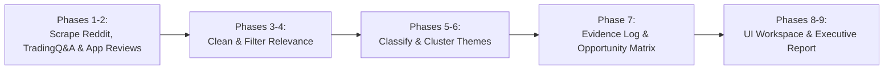

# Implementation Plan: AI-Powered SIP Retention Discovery Agent

> **Actionable Engineering Blueprint & Step-by-Step Execution Guide**  
> **Reference Baseline:** [`architecture.md`](file:///d:/PROJECT/AI_Discover_SIP/architecture.md) & [`problemStatement.md`](file:///d:/PROJECT/AI_Discover_SIP/problemStatement.md)  
> **Canonical Root Document:** [`implementation.md`](file:///d:/PROJECT/AI_Discover_SIP/implementation.md)  
> **Target Audience:** Growth Product Manager (No-Code User) & AI Implementation Assistant

---

## 1. Guiding Philosophy & Practical Approach

To deliver maximum research value without architectural bloat:
1. **Lightweight & Self-Contained:** Built entirely in **Python 3.12** using minimal dependencies (`requests`, `python-dotenv`). No complex databases or external server setups required.
2. **Multi-Source Qualitative Signals:** Ingests rich retail investor discussions across four complementary sources:
   * **Reddit:** Indian investing subreddits via Apify Actor.
   * **TradingQ&A:** Discourse-powered Indian retail investor forum via native search API (100% free, zero-key).
   * **Google Play Store & Apple App Store:** Real Groww user reviews regarding auto-pay, mandates, and cancellations.
3. **Incremental Validation:** Each stage writes transparent, human-readable JSON files into `data/raw/` and `data/processed/` so you can inspect the actual outputs before moving forward.
4. **Zero Coding Required for the PM:** Every stage is pre-scripted with a single terminal command.
5. **Data First, Dashboard Second:** The data pipeline is built and validated with real records first (Steps 1–9); the interactive visual dashboard is launched in Step 10 to display real, audited findings.



---

## 2. Directory & Module Blueprint

The project is structured to keep data, collectors, processing pipelines, and the user interface cleanly separated:

```
d:\PROJECT\AI_Discover_SIP\
├── .env                              # Stores APIFY_TOKEN (active & verified)
├── .gitignore                        # Protects .env and data/ from git
├── architecture.md                   # System technical architecture
├── problemStatement.md              # Core business goals & research questions
├── implementation.md                # This actionable execution guide
├── Docs\
│   ├── ProblemStatement.txt         # Original requirements document
│   ├── problemStatement.md          # Mirrored problem statement
│   ├── architecture.md              # Mirrored architecture
│   └── implementation.md            # Mirrored implementation plan
├── data\
│   ├── raw\                         # Immutable raw scrapes (Reddit, TradingQ&A, Reviews)
│   │   ├── reddit_pilot.json        # Reddit discussions via Apify
│   │   ├── tradingqna.json          # TradingQ&A discussions via Discourse API
│   │   └── app_reviews.json         # Play Store & App Store reviews
│   ├── processed\                   # Cleaned, filtered, and classified records
│   └── evidence_log.json            # Audit ledger for all AI findings & PM sign-offs
├── src\
│   ├── collectors\                  # Data collection modules
│   │   ├── __init__.py
│   │   ├── apify_reddit.py          # Reddit collector via Apify actor
│   │   ├── tradingqna_collector.py  # TradingQ&A forum collector (Discourse API)
│   │   └── review_collector.py      # Play Store & App Store review collector
│   ├── pipeline\                    # Sequential processing stages
│   │   ├── __init__.py
│   │   ├── cleaner.py               # Stage B: Cleaning & Deduplication
│   │   ├── relevance_filter.py      # Stage C: 5-Tier Relevance & Review Queue
│   │   ├── classifier.py            # Stage D: Behavioral & Pain Point Tagging
│   │   ├── clustering.py            # Stage E: Theme Discovery (13 baseline + dynamic)
│   │   └── synthesizer.py           # Stage F: Insight Synthesis & Opportunity Matrix
│   └── web\                         # Research Workspace UI (Phase 8)
│       ├── server.py                # Lightweight local web server
│       └── static\                  # HTML5, Vanilla CSS, and JavaScript workspace
└── scratch\                         # Temporary debug and exploration utilities
```

---

## 3. Step-by-Step Implementation Sequence

---

### Step 1: Environment Setup & Core Dependencies
* **Goal:** Install minimal necessary Python packages to make HTTP calls and manage environment variables.
* **Command:**
  ```powershell
  python -m pip install requests python-dotenv
  ```
* **Verification:** Confirm `requests` and `python-dotenv` are available.

---

### Step 2: Reddit Data Collection (Phase 2 Pilot)
* **Script:** `src/collectors/apify_reddit.py`
* **Objective:** Scrape 100–150 high-signal records from `r/IndiaInvestments`, `r/personalfinanceindia`, and `r/IndianStockMarket` using Apify Actor `trudax/reddit-scraper-lite`.
* **Execution Parameters:**
  * **Keywords:** `stopped SIP`, `cancelled SIP`, `paused SIP`, `SIP cancellation reasons`, `failed SIP instalment`, `SIP mandate problem`, `SIP negative returns`, `SIP affordability`, `first time SIP investment problems`.
  * **Hard Limit:** 150 items (costs ~$0.60 against your $5.00 free Apify monthly credit).
* **Output Artifact:** [`data/raw/reddit_pilot.json`](file:///d:/PROJECT/AI_Discover_SIP/data/raw/reddit_pilot.json)
* **PM Command:**
  ```powershell
  python -m src.collectors.apify_reddit
  ```
* **Validation Criteria:** File exists, contains 100+ items, each with `title`, `body/text`, `url` (live Reddit link), `upvotes`, and `published_at`.

---

### Step 3: TradingQ&A Forum Collection (Discourse API)
* **Script:** `src/collectors/tradingqna_collector.py`
* **Objective:** Collect rich retail investor discussions from [TradingQ&A](https://tradingqna.com/) regarding SIP debit failures, bank ECS charges, mandate rejections, and SIP cancellations.
* **Technical Mechanism:** TradingQ&A runs on Discourse, providing native public search endpoints (e.g. `https://tradingqna.com/search.json?q={query}`) that require **no API keys, zero cost, and no headless browsers**.
* **Target Queries:**
  * `SIP cancelled`
  * `SIP mandate failed`
  * `SIP stop vs pause`
  * `auto debit SIP penalty`
  * `SIP instalment bounce`
* **Output Artifact:** [`data/raw/tradingqna.json`](file:///d:/PROJECT/AI_Discover_SIP/data/raw/tradingqna.json)
* **PM Command:**
  ```powershell
  python -m src.collectors.tradingqna_collector
  ```
* **Validation Criteria:** File contains parsed forum threads with post title, author, full post text, like counts, and persistent permalinks (`https://tradingqna.com/t/{slug}/{id}`).

---

### Step 4: Secondary Sources Collection (Play Store & App Store)
* **Script:** `src/collectors/review_collector.py`
* **Objective:** Pull public user reviews for Groww from the Google Play Store and Apple App Store focusing on auto-pay, payment failures, and cancellations.
* **Output Artifact:** [`data/raw/app_reviews.json`](file:///d:/PROJECT/AI_Discover_SIP/data/raw/app_reviews.json)
* **PM Command:**
  ```powershell
  python -m src.collectors.review_collector
  ```
* **Validation Criteria:** Captures real user feedback specifically citing mandate rejections, bank bounce charges, or confusing SIP cancellation buttons.

---

### Step 5: Data Cleaning & Deduplication (Stage B)
* **Script:** `src/pipeline/cleaner.py`
* **Objective:**
  * Combine records from Reddit, TradingQ&A, and App Reviews into a unified schema.
  * Remove empty, spam, or deleted posts.
  * Standardize whitespace and normalize Unicode text.
  * Compute MD5 text hashes to eliminate identical duplicates.
  * Identify cross-posts between `r/IndiaInvestments`, `r/personalfinanceindia`, and forums.
  * Assign a permanent system ID to every record: `REC-00001`, `REC-00002`, etc.
* **Output Artifact:** [`data/processed/cleaned_records.json`](file:///d:/PROJECT/AI_Discover_SIP/data/processed/cleaned_records.json)
* **PM Command:**
  ```powershell
  python -m src.pipeline.cleaner
  ```
* **Validation Criteria:** Deduplication statistics reported across all sources (e.g., `Input: 220 records | Duplicates Removed: 22 | Cleaned Output: 198 records`).

---

### Step 6: 5-Tier Relevance Filtering & Review Queue (Stage C)
* **Script:** `src/pipeline/relevance_filter.py`
* **Objective:** Filter records so downstream analysis focuses exclusively on SIP retention problems.
* **Categorization Tiers:**
  * **Tier 1 (Directly Relevant):** Stopping, pausing, cancelling, reducing, or missing SIPs.
  * **Tier 2 (Indirectly Relevant):** First-time investor psychology, anxiety, return disillusionment.
  * **Tier 3 (App & Mandate Friction):** Auto-debit failures, UI confusion, bounce charges.
  * **Tier 4 (General Investing):** Stock picks, taxation, portfolio reviews without SIP connection.
  * **Tier 5 (Noise/Spam):** Unrelated personal finance questions.
* **Output Artifacts:**
  * [`data/processed/relevant_records.json`](file:///d:/PROJECT/AI_Discover_SIP/data/processed/relevant_records.json) (Tiers 1–3)
  * [`data/processed/review_queue.json`](file:///d:/PROJECT/AI_Discover_SIP/data/processed/review_queue.json) (Borderline confidence records flagged for PM inspection)
* **PM Command:**
  ```powershell
  python -m src.pipeline.relevance_filter
  ```
* **Validation Criteria:** Discards general macro chatter while capturing all retention-specific signals.

---

### Step 7: Granular Behavioral Classification & Quote Extraction (Stage D)
* **Script:** `src/pipeline/classifier.py`
* **Objective:** Extract structured qualitative metadata from every relevant record:
  * **Investor Stage:** `First-Time`, `Considering`, `Continuing`, `Paused`, `Cancelled`, `Unknown`.
  * **Reported Behaviour:** `Stopped`, `Paused`, `Reduced Amount`, `Failed Instalment`, `Continued`.
  * **Trigger Context:** `Salary delay`, `Market correction`, `Emergency expense`, `Bank bounce charge`.
  * **Problem Nature:** `App/Technical Mandate Friction` vs `Broader Financial/Cash-Flow Problem`.
  * **Exact Verbatim Quote:** Extracted sentence proving the behavior.
  * **Confidence Score:** 0.0 to 1.0.
* **Output Artifact:** [`data/processed/classified_records.json`](file:///d:/PROJECT/AI_Discover_SIP/data/processed/classified_records.json)
* **PM Command:**
  ```powershell
  python -m src.pipeline.classifier
  ```
* **Validation Criteria:** Zero hallucinated demographic tags (only records with explicit text evidence receive tags).

---

### Step 8: Semantic Theme Clustering (Stage E)
* **Script:** `src/pipeline/clustering.py`
* **Objective:** Group classified records into the 13 baseline operational hypotheses, plus detect any dynamic emerging themes:
  1. *Affordability & Cash-Flow Constraints*
  2. *Market Volatility Panic & Negative Returns*
  3. *Expectations vs Actual Performance*
  4. *Confusion Over XIRR / Performance Metrics*
  5. *Low Perceived Progress on Small SIPs*
  6. *Lack of Foundational Compounding Literacy*
  7. *Missed Instalments & Bank ECS Bounce Penalties*
  8. *Mandate & Payment Technical Failures*
  9. *App Usability & Information Clarity (e.g. Pause vs Cancel)*
  10. *Competing Financial Priorities (EMIs, Festivals)*
  11. *Social Influence & FinTech Influencer Advice*
  12. *Customer Support Delays & Trust Gaps*
  13. *Life Event Changes (Job Loss, Higher Education)*
* **Output Artifact:** [`data/processed/theme_clusters.json`](file:///d:/PROJECT/AI_Discover_SIP/data/processed/theme_clusters.json)
* **PM Command:**
  ```powershell
  python -m src.pipeline.clustering
  ```
* **Validation Criteria:** Every cluster reports: record count, unique sources (Reddit vs TradingQ&A vs Reviews), sample quotes, and counterexamples.

---

### Step 9: Insight Synthesis & Opportunity Prioritization (Stage F & Phase 7)
* **Script:** `src/pipeline/synthesizer.py`
* **Objective:**
  * Generate structured problem hypotheses with **explicit denominators** (e.g., *32 out of 95 churned users cited fear of repeated ₹450 bank bounce charges*).
  * Calculate Opportunity Priority Scores (OPS) using the 8-dimensional weighted matrix (12-month retention link, evidence strength, severity, Groww addressability, unmet need, sample prevalence, source diversity, low assumptions).
  * Store all findings in the persistent audit ledger with verification flags.
* **Output Artifacts:**
  * [`data/evidence_log.json`](file:///d:/PROJECT/AI_Discover_SIP/data/evidence_log.json) (AI Evidence Log)
  * [`data/processed/opportunity_matrix.json`](file:///d:/PROJECT/AI_Discover_SIP/data/processed/opportunity_matrix.json)
* **PM Command:**
  ```powershell
  python -m src.pipeline.synthesizer
  ```
* **Validation Criteria:** No recommendations for specific funds or manipulative FOMO nudges. Pure problem validation.

---

### Step 10: Launch the Research Workspace UI (Phase 8)
* **Script:** `src/web/server.py`
* **Frontend:** `src/web/static/` (HTML5, Vanilla CSS with clean modern dark/light mode, JavaScript)
* **Objective:** Launch a local web platform accessible at `http://localhost:5000` giving the Growth PM full interactive control:
  1. **Overview Dashboard:** Total records across Reddit, TradingQ&A, and App Reviews; pipeline status.
  2. **Data Collection Runner:** Form to trigger additional keyword scrapes.
  3. **Data Quality & Triage:** Inspect deduplication and review borderline records.
  4. **Conversation Explorer:** Search, filter by source (Reddit / TradingQ&A / Play Store), stage, and behavior.
  5. **Theme Explorer:** Explore the 13 clusters with verbatims and counterevidence.
  6. **Segment Analysis:** Compare First-time vs Experienced and Retained vs Churned cohorts.
  7. **Opportunity Assessment Board:** Interactive quadrant prioritization matrix.
  8. **AI Evidence Log:** Audit interface where the PM can click `[Accept]`, `[Revise]`, or `[Reject]`.
  9. **Research Questions Tracker:** List of open questions and suggested user interview questions.
  10. **Data & Report Export:** Instant download of cleaned CSV datasets, theme summary tables, and executive discovery slide decks in Markdown.
* **PM Command:**
  ```powershell
  python -m src.web.server
  ```
* **Validation Criteria:** UI opens smoothly in browser, displays real multi-source data, and allows interactive exploration.

---

### Step 11: Executive Discovery Report (Phase 9)
* **Script:** `src/pipeline/generate_report.py`
* **Objective:** Compiles all accepted insights, evidence quotes across Reddit, TradingQ&A, and Reviews, and the prioritized problem matrix into a presentation-ready executive document.
* **Output Artifact:** [`Docs/final_discovery_report.md`](file:///d:/PROJECT/AI_Discover_SIP/Docs/final_discovery_report.md)
* **PM Command:**
  ```powershell
  python -m src.pipeline.generate_report
  ```

---

## 4. Summary Execution Checklist for the PM

| Step | Action | Script to Execute | Status | Output Created |
| :---: | :--- | :--- | :---: | :--- |
| **1** | Install Dependencies | `pip install -r requirements.txt` | ✅ Complete | Streamlit, Groq, Plotly, Pandas installed |
| **2** | Reddit Multi-Source Scrape | `python -m src.collectors.apify_reddit` | ✅ Complete | `data/raw/reddit_pilot.json` & `reddit_comprehensive.json` (144 items) |
| **3** | TradingQ&A Forum Scrape | `python -m src.collectors.tradingqna_collector` | ✅ Complete | `data/raw/tradingqna.json` (150 items) |
| **4** | App Reviews Scrape | `python -m src.collectors.review_collector` | ✅ Complete | `data/raw/app_reviews.json` (40 items) |
| **5** | Clean & Deduplicate | `python -m src.pipeline.cleaner` | ✅ Complete | `data/processed/cleaned_records.json` (321 unique records) |
| **6** | Filter Relevance | `python -m src.pipeline.relevance_filter` | ✅ Complete | `data/processed/relevant_records.json` (77 signals) & `review_queue.json` (13 triage) |
| **7** | Classify Behaviors | `python -m src.pipeline.classifier` | ✅ Complete | `data/processed/classified_records.json` (Structured verbatims & behavioral tags) |
| **8** | Cluster Themes | `python -m src.pipeline.clustering` | ✅ Complete | `data/processed/theme_clusters.json` (13 baseline hypotheses) |
| **9** | Synthesize Insights | `python -m src.pipeline.synthesizer` | ✅ Complete | `data/evidence_log.json` & `data/processed/opportunity_matrix.json` |
| **10** | Launch Streamlit Dashboard | `streamlit run app.py` | ✅ Complete | 10-module Dark Theme workspace with Groq 120B Assistant |
| **11** | Executive Discovery Report | `python -m src.pipeline.generate_report` | ✅ Complete | `Docs/final_discovery_report.md` |

---

## 5. Deployment & Execution Summary

All data ingestion, cleaning, classification, clustering, prioritization, and UI workspace modules are fully operational.
* **Streamlit Workspace:** Run `streamlit run app.py` to open the complete research platform.
* **Groq Flagship LLM:** Configured with `openai/gpt-oss-120b` (120-Billion parameter Big Model) with deep reasoning traces.
* **Ready for Git Remote:** Codebase, documentation, and audited datasets are prepared to push to your repository.

