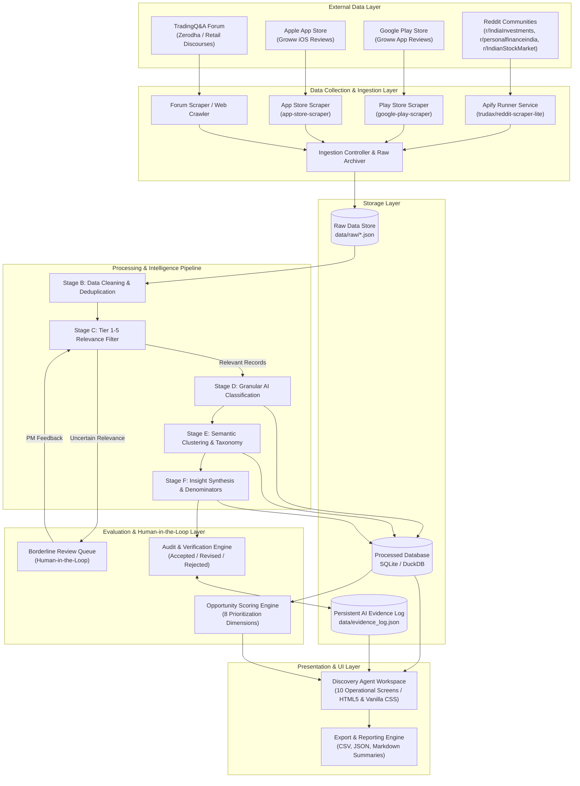
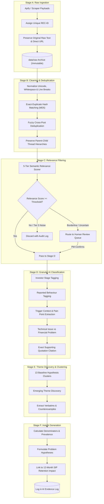
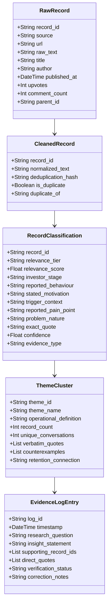
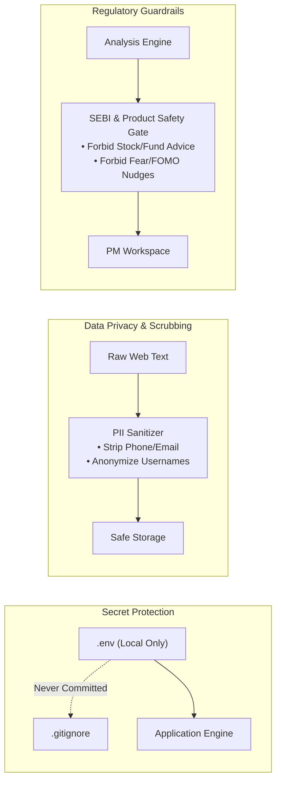

# System Architecture: AI-Powered SIP Retention Discovery Agent

> **Technical Architecture & System Design Document**  
> **Project:** Groww AI-Powered SIP Retention Discovery Agent  
> **Reference Baseline:** [`problemStatement.md`](file:///d:/PROJECT/AI_Discover_SIP/problemStatement.md) & [`Docs/ProblemStatement.txt`](file:///d:/PROJECT/AI_Discover_SIP/Docs/ProblemStatement.txt)  
> **Target Persona:** Growth Product Manager & AI Engineering Lead

---

## 1. Architectural Principles & System Vision

The AI Discovery Agent is engineered as an **evidence-first, human-in-the-loop qualitative intelligence platform**. Its primary objective is not predictive forecasting or financial advice, but **uncovering the empirical root causes** of why first-time investors reduce, pause, cancel, or abandon Systematic Investment Plans (SIPs) within their first 12 months.

```
┌─────────────────────────────────────────────────────────────────────────────────┐
│                           CORE ARCHITECTURAL PILLARS                            │
├────────────────────┬────────────────────┬───────────────────┬───────────────────┤
│ Evidence Integrity │ Explainable AI     │ Zero-Code for PM  │ Strict Guardrails │
│ Every insight must │ Granular citations │ Web workspace     │ No stock advice,  │
│ link to immutable  │ with confidence    │ with visual queues│ no FOMO nudges,   │
│ verbatims & URLs.  │ & counterevidence. │ & one-click runs. │ no hallucinations.│
└────────────────────┴────────────────────┴───────────────────┴───────────────────┘
```

---

## 2. High-Level System Architecture (C4 Model - Level 2)



---

## 3. End-to-End Processing Pipeline Architecture

The pipeline transforms unstructured conversational threads into mathematically bounded, verified qualitative insights across six sequential stages:



---

## 4. Component Deep-Dive & Data Contracts

### 4.1 Data Ingestion Subsystem (`src/collectors/`)
* **Apify Reddit Connector (`src/collectors/reddit_collector.py`):**
  * Communicates via REST with Apify Actor `trudax/reddit-scraper-lite`.
  * Authenticates securely using `APIFY_TOKEN` loaded from [`.env`](file:///d:/PROJECT/AI_Discover_SIP/.env).
  * Executes query batches partitioned by target subreddits (`r/IndiaInvestments`, `r/personalfinanceindia`, `r/IndianStockMarket`).
  * Enforces maximum limits (e.g., 100–150 records in pilot) to guarantee zero budget overruns.
* **App Review Scraper (`src/collectors/review_collector.py`):**
  * Queries Google Play Store and Apple App Store for Groww app reviews.
  * Filters reviews containing keywords: `SIP`, `mandate`, `auto-debit`, `deducted`, `cancelled`.

### 4.2 Core Data Models & Schemas



#### Detailed JSON Schema Definitions:

##### 1. Cleaned & Filtered Record Schema
```json
{
  "record_id": "REC-00124",
  "source": "reddit/r/personalfinanceindia",
  "url": "https://www.reddit.com/r/personalfinanceindia/comments/...",
  "published_at": "2026-08-14T10:22:00Z",
  "raw_text": "I had to stop my SIP in Parag Parikh because of sudden medical expenses...",
  "normalized_text": "I had to stop my SIP in Parag Parikh because of sudden medical expenses...",
  "relevance": {
    "tier": "Tier 1: Directly Relevant",
    "score": 0.94,
    "confidence": 0.92,
    "human_review_required": false
  },
  "classification": {
    "investor_stage": "First-Time",
    "reported_behaviour": "Stopped",
    "trigger_context": "Unplanned emergency expense",
    "reported_pain_point": "Lack of emergency buffer; unable to pause without cancelling",
    "problem_nature": "Broader Financial Problem with In-App Flexibility Friction",
    "evidence_type": "Direct Quote",
    "verbatim_quote": "I had to stop my SIP... because of sudden medical expenses and couldn't just skip two months easily."
  }
}
```

##### 2. AI Evidence Log Schema
```json
{
  "log_id": "LOG-20261022-01",
  "timestamp": "2026-10-22T21:35:00Z",
  "research_question": "Why do first-time investors discontinue SIPs within 6 months?",
  "insight_statement": "Users treat SIP cancellations as an emergency pause mechanism when faced with medical or festival cash crunches due to fear of bank bounce fees.",
  "evidence_count": 28,
  "denominator": 84,
  "unique_sources": 3,
  "citations": [
    {
      "record_id": "REC-00124",
      "url": "https://reddit.com/...",
      "quote": "Cancelled because bank was charging Rs 450 every time debit failed."
    }
  ],
  "verification_status": "Accepted",
  "audited_by": "Product Manager (Growth)",
  "corrections": "Confirmed. ECS bounce charge penalty is a primary driver of proactive mandate cancellation."
}
```

---

## 5. Opportunity Prioritization Matrix Engine

Rather than treating high raw conversation frequency as proof of severity, the Opportunity Scoring Engine calculates a multi-dimensional weighted score:

$$\text{Opportunity Priority Score (OPS)} = \sum_{i=1}^{8} (w_i \times S_i)$$

```mermaid
radar-chart
    title "Opportunity Evaluation Dimensions (Weights)"
    "12-Month Retention Link (25%)" : 25
    "Direct Evidence Strength (20%)" : 20
    "Problem Severity (15%)" : 15
    "Groww Addressability (15%)" : 15
    "Unmet Need Evidence (10%)" : 10
    "Sample Prevalence (5%)" : 5
    "Source Diversity (5%)" : 5
    "Unresolved Assumptions (-5%)" : 5
```

| Dimension | Description | Weight ($w_i$) | Scale |
| :--- | :--- | :--- | :--- |
| **1. 12-Month Retention Link** | Direct qualitative link to maintaining active SIP status | **25%** | 1 (Low) to 5 (Direct Cause) |
| **2. Direct Evidence Strength** | Supported by verbatim quotes vs speculative extrapolation | **20%** | 1 (Speculative) to 5 (Direct Proof) |
| **3. Problem Severity** | Emotional and financial cost (e.g. bounce penalties vs minor UI layout) | **15%** | 1 (Trivial) to 5 (Severe Loss/Panic) |
| **4. Groww Addressability** | Can Groww solve this via UX, banking flows, or education? | **15%** | 1 (Macro/Uncontrollable) to 5 (High UX Leverage) |
| **5. Unmet Need Evidence** | Users actively seeking workarounds or expressing missing tools | **10%** | 1 (No Demand) to 5 (Active Workarounds) |
| **6. Sample Prevalence** | Proportion of relevant sample mentioning this issue | **5%** | 1 (<5%) to 5 (>30%) |
| **7. Source Diversity** | Validated across multiple independent communities | **5%** | 1 (Single Thread) to 5 (Cross-Platform) |
| **8. Low Assumptions** | Degree to which problem is validated without unproved guesses | **5%** | 1 (Many Assumptions) to 5 (Fully Grounded) |

---

## 6. Research Workspace Interface Architecture (UI Modules)

The system exposes a clean, intuitive web application requiring zero command-line interaction from the Growth PM:

```
┌─────────────────────────────────────────────────────────────────────────────┐
│                       GROWW SIP DISCOVERY AGENT UI                          │
├─────────────────┬───────────────────────────────────────────────────────────┤
│ NAVIGATION      │ ACTIVE WORKSPACE VIEW                                     │
├─────────────────┼───────────────────────────────────────────────────────────┤
│ 1. Overview     │ • Dataset Size: 182 Records | 3 Sources | 94% Valid Links │
│ 2. Collection   │ • Pipeline Status: Ingestion [Complete] -> Stage E [Done] │
│ 3. Data Quality ├───────────────────────────────────────────────────────────┤
│ 4. Explorer     │ TOP DISCOVERED RETENTION FRICTIONS:                       │
│ 5. Themes       │ 1. Bank ECS Bounce Fee Fear (28 mentions, High Severity)  │
│ 6. Segments     │ 2. Disillusionment with 1-Year Returns (24 mentions)      │
│ 7. Opportunity  │ 3. Cash-Flow Timing Mismatch vs Salary Day (19 mentions)  │
│ 8. Evidence Log ├───────────────────────────────────────────────────────────┤
│ 9. Open Qs      │ HUMAN REVIEW QUEUE:                                       │
│ 10. Export      │ [REC-00142] "SIP deduction failed" -> [Verify] [Reject]   │
└─────────────────┴───────────────────────────────────────────────────────────┘
```

### Module Breakdown:
1. **Overview Dashboard:** Executive summary cards showing dataset health, total records collected, source distribution, and pipeline run status.
2. **Data Collection Runner:** Interactive search query builder, subreddit toggles, record count limits, and a one-click "Trigger Scrape" button.
3. **Data Quality & Triage:** Deduplication reports, missing metadata flags, and the Human Review Queue for borderline relevance records.
4. **Conversation Explorer:** Searchable tabular view with multi-faceted filtering (investor stage, reported behavior, sentiment) and clickable source URLs.
5. **Theme Explorer:** Interactive cluster cards detailing operational definitions, record counts, representative verbatim quotes, and counterevidence.
6. **Segment Analysis View:** Cross-tabulation matrices comparing first-time vs experienced investors and retained vs churned users.
7. **Opportunity Assessment Board:** Dynamic quadrant chart prioritizing problems by Groww addressability and severity.
8. **AI Evidence Log:** Full audit ledger tracking prompts, outputs, confidence levels, PM verifications, and correction notes.
9. **Research Questions Tracker:** Central repository of open hypotheses, unresolved questions, and drafted user interview/survey questions.
10. **Data & Report Export:** Instant download of cleaned CSV datasets, theme summary tables, and executive discovery slide decks in Markdown.

---

## 7. Security, Privacy & Compliance Architecture



1. **Credential Isolation:** API keys (Apify, LLM tokens) are strictly stored in local `.env` files and blocked via `.gitignore`. Keys are never logged or embedded in artifacts.
2. **PII Sanitization:** The ingestion pipeline automatically scrubs personal identifiable information (emails, phone numbers, bank account numbers) prior to downstream LLM processing.
3. **Compliance Safety Gate:** The insight synthesis prompt incorporates explicit system-level negative constraints:
   * *Never recommend specific mutual funds, AMCs, or equity tickers.*
   * *Never recommend deceptive, fear-based, or urgency-driven user nudges.*

---

## 8. Repository & File Structure

```
d:\PROJECT\AI_Discover_SIP\
├── .env                              # Private environment variables (Apify Token, etc.)
├── .gitignore                        # Git exclusion rules (protects .env and data/)
├── architecture.md                   # Canonical technical architecture document
├── problemStatement.md              # Canonical problem statement & discovery goals
├── Docs\
│   ├── ProblemStatement.txt         # Original input specification
│   ├── problemStatement.md          # Mirror of problem statement
│   └── architecture.md              # Mirror of architecture document
├── data\
│   ├── raw\                         # Immutable raw scrapes (reddit_pilot.json)
│   ├── processed\                   # Cleaned, deduplicated, and classified records
│   └── evidence_log.json            # Persistent AI evidence log & PM review history
├── src\
│   ├── collectors\                  # Scraper integrations (Apify, Play Store)
│   │   ├── __init__.py
│   │   ├── apify_reddit.py          # Apify Reddit actor runner & downloader
│   │   └── playstore_scraper.py     # App review fetcher
│   ├── pipeline\                    # Sequential processing stages
│   │   ├── __init__.py
│   │   ├── cleaner.py               # Normalization & deduplication (Stage B)
│   │   ├── relevance_filter.py      # Tier 1-5 classification (Stage C)
│   │   ├── classifier.py            # Behavioral & stage tagging (Stage D)
│   │   ├── clustering.py            # Theme & cluster discovery (Stage E)
│   │   └── synthesizer.py           # Insight synthesis & denominators (Stage F)
│   ├── storage\                     # Database & file handlers
│   │   ├── db.py                    # SQLite / JSON storage manager
│   │   └── models.py                # Pydantic data schemas
│   └── web\                         # Research workspace UI
│       ├── app.py                   # Local web server (Python http/Flask)
│       └── static\                  # HTML, CSS, JavaScript interface
└── scratch\                         # Temporary debug and exploration scripts
```

---

## 9. Phased Implementation Roadmap Mapping

| Phase | Roadmap Milestone | Key Architectural Deliverable |
| :---: | :--- | :--- |
| **Phase 1** | Tool Inspection & Architecture | Verify Apify API credentials, actor schemas, and environment security. *(Completed)* |
| **Phase 2** | Reddit Pilot Data Collection | Run `apify_reddit.py` to extract 100–150 records into `data/raw/reddit_pilot.json`. |
| **Phase 3** | Dataset & Link Validation | Data audit utility verifying text integrity, comment threads, and live URLs. |
| **Phase 4** | Cleaning & Relevance Pipeline | Implement `cleaner.py` and `relevance_filter.py` with Human Review Queue. |
| **Phase 5** | Classification & Theme Discovery | Implement `classifier.py` and `clustering.py` for 13 baseline + emerging themes. |
| **Phase 6** | Insights & Segment Comparisons | Implement `synthesizer.py` with explicit denominators and cohort comparisons. |
| **Phase 7** | Persistent AI Evidence Log | Build `evidence_log.json` and interactive audit/correction tracking loop. |
| **Phase 8** | Discovery Workspace UI | Launch 10-screen web dashboard with live filters and export capabilities. |
| **Phase 9** | End-to-End Validation Run | Full execution on real multi-channel datasets and final executive report delivery. |
