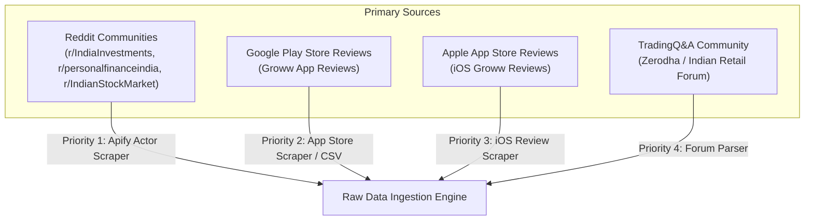
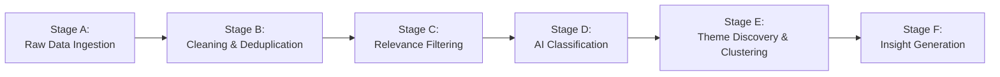
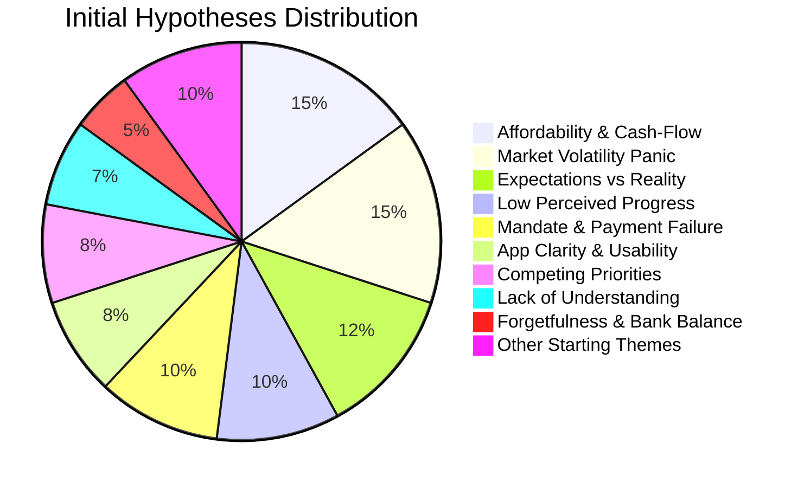
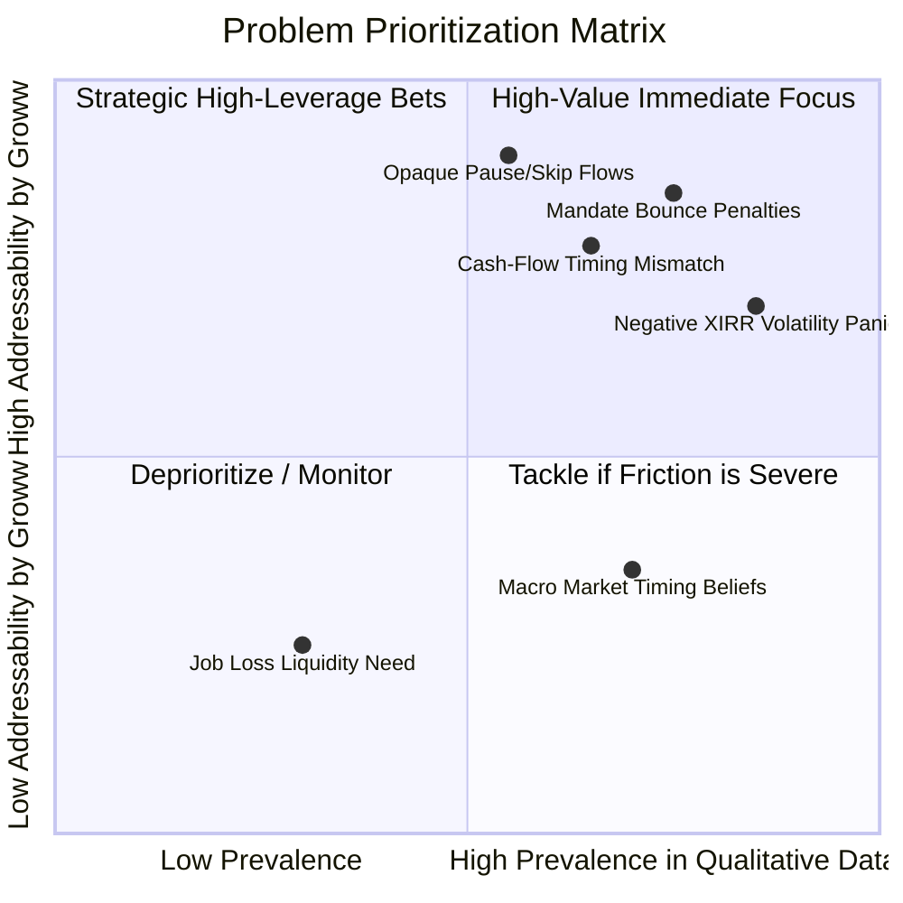
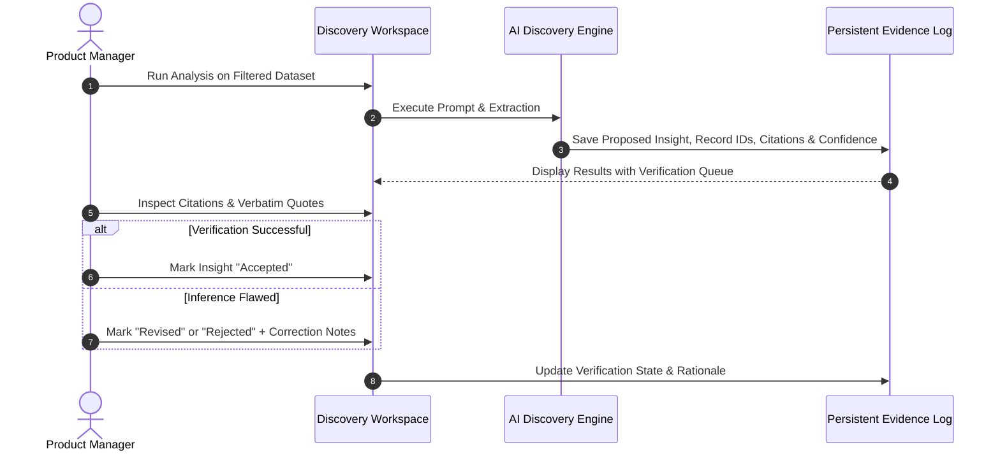
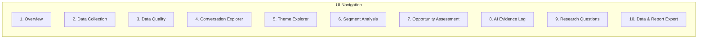

# AI-Powered SIP Retention Discovery Agent for Groww

> **Project Reference Document & System Architecture**  
> **Target Audience:** Growth Product Team at Groww  
> **Source Context:** Transcribed and structured from [`Docs/ProblemStatement.txt`](file:///d:/PROJECT/AI_Discover_SIP/Docs/ProblemStatement.txt)  
> **Canonical Document:** [`Docs/problemStatement.md`](file:///d:/PROJECT/AI_Discover_SIP/Docs/problemStatement.md)

---

## 1. Executive Summary & Problem Context

### 1.1 The Business Problem
Groww has made starting a Systematic Investment Plan (SIP) remarkably seamless. However, investor retention over a 12-month horizon presents significant drop-offs: users frequently reduce instalments, pause investments, cancel mandates, or discontinue altogether.

```
       [Day 0: High Intent]                         [Months 1 - 12: Drop-Off Risk]
┌─────────────────────────────────┐               ┌─────────────────────────────────┐
│  First-Time Investor Starts     │ ────────────> │ • Reduces SIP instalment amount │
│  First SIP (Low Friction)       │               │ • Pauses or skips instalments   │
└─────────────────────────────────┘               │ • Cancels SIP mandate           │
                                                  │ • Completely discontinues       │
                                                  └─────────────────────────────────┘
                                                                   │
                                                      [Root Causes Unknown]
```

### 1.2 Strategic Goal & Core KPI
* **Strategic Objective:** Increase the percentage of first-time mutual fund investors who maintain an **active SIP 12 months after initiating their first SIP**.
* **Strict Metric Definition:** An **Active SIP** is defined strictly as **at least one successful instalment processed within the preceding 30 days**.
* **Core Research Mandate:** We do not know the underlying user problem. The objective of this project is to discover, categorize, and validate it using evidence-based public qualitative research before committing product development resources.

### 1.3 Solution Guardrails & Non-Goals
To preserve regulatory compliance, brand integrity, and scientific objectivity, the discovery agent and all generated recommendations must adhere to strict boundary rules:

| Category | Guardrail / Constraint | Rationale |
| :--- | :--- | :--- |
| **No Financial Advice** | Strictly forbid recommending specific mutual funds, AMC schemes, or individual stocks. | Regulatory compliance (SEBI regulations) and product neutrality. |
| **No Manipulative Nudges** | Exclude fear-based, FOMO-based (fear of missing out), anxiety-inducing, or artificial urgency nudges. | Sustainable retention requires financial wellness, not psychological coercion. |
| **No Premature Assumptions** | Never treat team or stakeholder assumptions as validated user problems. | Root causes must be grounded in documented user verbatims. |
| **No Solutioneering First** | Forbid proposing feature solutions before the underlying problem is empirically established. | Prevents building high-effort solutions for non-existent or misdiagnosed issues. |

---

## 2. Agent Role & Working Protocol

### 2.1 Role Definition
The discovery system acts as a multi-disciplinary autonomous partner:
* **Senior AI Engineer:** Architecting clean ingestion pipelines, prompt orchestrations, and data stores.
* **Product Discovery Researcher:** Synthesizing unstructured user language into actionable behavioral patterns.
* **Data Analyst:** Enforcing statistical rigor, denominators, classification confidences, and deduplication.
* **No-Code Implementation Guide:** Ensuring the Growth PM can manage, run, inspect, and audit the agent without writing manual code.

### 2.2 Operational Working Rules
1. **Zero Hallucination / Zero Fabrication:** Do not claim any dataset has been collected, scraped, processed, or validated unless actual executions have occurred.
2. **Explicit Action Guidance:** When an external action is required (e.g., retrieving API keys, approving Apify actor runs), provide clear, step-by-step instructions.
3. **Evidence Distinction:** Every artifact generated must strictly delineate between:
   * **Direct Evidence:** Verbatim quotes and observable facts reported by users.
   * **Inferred Hypotheses:** Deductions derived logically from clustered evidence.
   * **Open Questions:** Hypotheses lacking sufficient sample size or internal data corroboration.

---

## 3. The 10 Core Research Questions

The AI Discovery Agent is designed to extract answers to the following 10 strategic questions from qualitative investor discourse:

```mermaid
mindmap
  root((SIP Retention Discovery))
    1. Motivation & Expectations
      Why do users start their first SIP?
      What returns / outcomes do they anticipate?
    2. Post-Start Behavioral Shifts
      What shifts occur in months 1 to 12?
      How does initial optimism change?
    3. Triggers for Discontinuation
      Why reduce, pause, cancel, or stop?
      What life/financial shocks trigger it?
    4. Monitoring Habits
      What do investors inspect inside the app?
      How frequently do they check returns?
    5. In-App Friction & Confusion
      What confuses or panics them in the UI?
      NAV delays, mandates, negative XIRR?
    6. External Workarounds & Coping
      What do they do when uncertain?
      Reddit posts, YouTube, peers, panic sales?
    7. Retained vs Churned Divergence
      What sets 12m active investors apart?
      Mindset, fund choice, or emergency cushion?
    8. Segment Nuances
      Income stability (salaried vs gig)?
      Age, source of capital, social peer pressure?
    9. Unmet User Needs
      Cash-flow alignment, mental peace, literacy?
      Flexible auto-pause vs hard cancellations?
    10. Product Opportunities
      Which interventions meaningfully impact retention?
      Non-coercive features addressing root causes?
```

---

## 4. Data Collection Architecture & Sources

### 4.1 Prioritized Data Sources



| Source | Priority | Collection Mechanism | Constraints & Guidelines |
| :--- | :--- | :--- | :--- |
| **Reddit India Communities** | **Priority 1 (Immediate)** | **Apify Reddit Scraper Actor** (cost-optimized) | Avoid native Reddit API due to rate limits, pricing, and blocked keys. Rely on verified Apify actors with public access only. |
| **Google Play Store Reviews** | **Priority 2** | Play Store review scraper / public export | Target reviews mentioning keywords (SIP, auto-debit, mandate, cancelled, deduction). |
| **Apple App Store Reviews** | **Priority 3** | App Store RSS / public scraper | Capture iOS user sentiment and payment/mandate specific failure reports. |
| **TradingQ&A** | **Priority 4** | Web scraping / public forum dumps | Rich discussions on technicalities of SIP processing, STP, AMC mandates, and market drops. |

### 4.2 Seed Search Queries (Reddit & Forums)
To target conversations with high signal-to-noise ratio regarding SIP abandonment, the following 20 seed keywords must be executed:

```
 1. stopped SIP                        11. checking mutual fund returns
 2. cancelled SIP                      12. disappointing SIP returns
 3. paused SIP                         13. continue SIP during market fall
 4. why stop investing                 14. irregular income SIP
 5. first SIP experience               15. SIP cancellation reasons
 6. SIP negative returns               16. mutual fund redemption regret
 7. SIP affordability                  17. SIP amount reduction
 8. mutual fund beginner mistakes      18. mutual fund investor anxiety
 9. SIP mandate problem                19. first time SIP investment
10. failed SIP instalment              20. first time SIP investment problems
```

### 4.3 Pilot Dataset Specification
* **Sample Size:** 100 to 200 records in the initial pilot run.
* **Fields Captured:**
  * Original raw text (immutable).
  * Post title & thread parent context.
  * Direct clickable post and comment URLs.
  * Source platform & subreddit / community name.
  * Publication timestamp (ISO 8601).
  * Engagement metrics (upvotes, comment count, score).
  * Unique record ID & Parent/Child relationship IDs.

---

## 5. End-to-End Data Processing Pipeline

The system processes raw qualitative inputs through six strictly ordered stages:



### Stage A: Raw Data Ingestion
* Import raw datasets from Apify runs, CSVs, or JSON payloads.
* Preserve original immutable source text and exact URLs.
* Assign a system-wide unique record ID (`REC-XXXXX`).
* Store raw source files in an audit-ready raw archive.

### Stage B: Data Cleaning & Normalization
* Filter out malformed, blank, or bot-generated records.
* Normalize whitespace, encoding artifacts, and casing without altering semantic meaning.
* Perform exact-duplicate matching and identify near-duplicates (cross-posts across `r/IndiaInvestments` and `r/personalfinanceindia`).
* **Thread Context Integrity:** Maintain parent-child hierarchies; do not treat isolated comments as disconnected standalone conversations.

### Stage C: Relevance Filtering
Every record is classified into one of five functional relevance tiers:
1. **Tier 1 (Directly Relevant):** Explicitly discusses starting, continuing, reducing, pausing, cancelling, or missing SIP instalments.
2. **Tier 2 (Indirectly Relevant):** First-time investor psychology, financial anxiety, return expectations, or decision-making.
3. **Tier 3 (App & Platform Friction):** Mandate issues, auto-pay failures, NAV allocation delays, UI confusion, or statement opacity.
4. **Tier 4 (General Investing):** Macro discussions, fund portfolio reviews, taxation (LTCG/STCG) without a SIP retention nexus.
5. **Tier 5 (Irrelevant / Unusable):** Noise, spam, unrelated personal finance topics.

> [!NOTE]
> Borderline records are routed to a **Human Review Queue** with relevance scores, confidence metrics, and verbatim evidence snippets. App complaints are not classified as retention problems unless a clear behavioural connection is supported.

### Stage D: Granular AI Classification
Relevant records are tagged across multi-dimensional behavioral metadata:

```
┌─────────────────────────────────────────────────────────────────────────────┐
│                       RECORD CLASSIFICATION SCHEMA                          │
├──────────────────────────┬──────────────────────────────────────────────────┤
│ Investor Stage           │ Considering | First-Time | Continuing | Paused | │
│                          │ Cancelled | Unknown                              │
├──────────────────────────┼──────────────────────────────────────────────────┤
│ Reported Behaviour       │ Started | Continued | Increased | Reduced |       │
│                          │ Paused | Cancelled | Failed Instalment | Unknown │
├──────────────────────────┼──────────────────────────────────────────────────┤
│ Stated Motivation        │ Wealth creation, tax saving, retirement, FOMO... │
├──────────────────────────┼──────────────────────────────────────────────────┤
│ Trigger Context          │ Salary delay, market crash, unexpected expense...│
├──────────────────────────┼──────────────────────────────────────────────────┤
│ Reported Pain Point      │ Bank mandate rejected, negative XIRR panic...    │
├──────────────────────────┼──────────────────────────────────────────────────┤
│ Problem Nature           │ App/Technical Issue vs Broader Financial Problem │
├──────────────────────────┼──────────────────────────────────────────────────┤
│ External Action Taken    │ Asked on Reddit, stopped auto-debit, redeemed... │
├──────────────────────────┼──────────────────────────────────────────────────┤
│ Evidence Type            │ Direct Quote | Indirect Inference | Speculative  │
├──────────────────────────┼──────────────────────────────────────────────────┤
│ Audit Metadata           │ Confidence (0-100%), Exact Quote, Source URL     │
└──────────────────────────┴──────────────────────────────────────────────────┘
```

> [!IMPORTANT]
> Demographic attributes (income stability, age, funding source) are captured **only** when explicitly stated. Demographics must never be hallucinated or inferred without direct textual evidence.

### Stage E: Theme Discovery & Semantic Clustering
The taxonomy starts with 13 baseline operational hypotheses, allowing emerging themes to develop dynamically:



1. **Affordability & Cash-Flow Constraints:** Liquidity crunches, salary delays, emergency cash drains.
2. **Competing Financial Priorities:** EMI payments, wedding/festival expenses, insurance premiums.
3. **Expectations vs. Actual Returns:** Disillusionment with 1-year returns failing to beat fixed deposits.
4. **Confusion Over Investment Performance:** Inability to interpret XIRR vs Absolute Returns vs NAV.
5. **Market Volatility & Uncertainty:** Discontinuing SIPs during market corrections out of panic.
6. **Low Perceived Progress:** Feeling that small monthly contributions (₹500–₹2,000) are not compounding.
7. **Lack of Foundational Financial Literacy:** Misunderstanding SIP mechanics, compounding horizons, or risk profiles.
8. **Missed Instalments & Penalties:** Bank ECS bounce charges triggering intentional mandate cancellations.
9. **Mandate & Payment Failures:** Technical auto-pay rejections via NPCI/e-mandate/UPI autopay.
10. **App Usability & Information Clarity:** Unclear SIP pause buttons, confusing cancellation flows, or slow portfolio updates.
11. **Social Influence & External Advice:** Peers, FinTech influencers, or relatives advising market timing.
12. **Trust & Customer Support Gaps:** Unresolved support tickets regarding deducted money not reflecting in units.
13. **Changes in Personal Circumstances:** Job loss, career transition, or higher education.

### Stage F: Structured Insight Generation
Each generated insight must be formulated with full scientific rigor rather than casual summaries:
* **Insight Statement:** Concise synthesis of the behavioural phenomenon.
* **User Problem Hypothesis:** The underlying friction or unmet need.
* **Evidence Count & Denominator:** Number of records evidencing this over the total relevant cohort.
* **Unique Source Diversity:** Distribution across subreddits and review platforms.
* **Verbatim Quotations:** Direct quotes with persistent link citations.
* **Counterevidence:** Documented scenarios where the opposite investor behavior was observed.
* **Segment Specificity:** Applicability across identified segments.
* **Connection Strength:** Qualitative link to 12-month retention.
* **Open Questions:** What internal analytics or interviews are required to validate this further.

---

## 6. Segment Comparison Framework

Where evidence permits, the agent conducts comparative analyses across key cohort axes:

| Cohort Axis | Group A | Group B | Key Research Focus |
| :--- | :--- | :--- | :--- |
| **Experience** | First-Time SIP Starters | Experienced Investors | What triggers early drop-off before habit formation? |
| **Retention Status** | 12-Month Retained | Churned / Stopped (<12m) | What mental models or safety nets protected the continuing group? |
| **Income Type** | Fixed Salaried Income | Variable / Freelance / Gig | How does income predictability impact instalment consistency? |
| **Decision Origin** | Self-Initiated / Researched | Socially Influenced / Ad-driven | Does external FOMO correlation lead to higher early cancellation? |
| **App Monitoring** | Daily / Weekly Checkers | "Set-and-Forget" Investors | Does frequent portfolio checking correlate with volatility panic? |
| **Friction Type** | Experienced Mandate Issues | Smooth Payment Processing | How many cancellations stem from payment glitches vs intentional exit? |

> [!WARNING]
> Denominators and sample sizes must always be reported. The agent must never infer population-level Groww metrics from self-selected public discussion boards.

---

## 7. Opportunity Prioritization Matrix

Candidate product opportunities are evaluated across 8 distinct dimensions to prioritize problem validation over premature development:



### Prioritization Scoring Dimensions:
1. **Relevance to 12-Month SIP Retention:** Direct linkage to sustaining active SIP status.
2. **Strength of Direct Evidence:** Volume of verbatim quotes vs speculative inferences.
3. **Prevalence in Sample:** Relative frequency among relevant qualitative conversations.
4. **Source Diversity:** Independent presence across multiple communities and channels.
5. **Severity of Problem:** Financial or emotional cost to the user (e.g., bank bounce fees vs mild aesthetic confusion).
6. **Evidence of Unmet Need:** Clear indication of current workarounds or lack of solutions.
7. **Addressability by Groww:** Feasibility within Groww's product, design, and regulatory ecosystem.
8. **Unresolved Assumptions:** Number of critical unknowns requiring internal telemetry.

---

## 8. AI Evidence Log & Audit Workflow

To eliminate hallucinations and maintain research integrity, every analysis step is logged in a persistent audit trail.



### Verification States:
* `Accepted`: Thoroughly supported by linked citations with zero hallucinations.
* `Revised`: Insight statement refined to match exact quote boundaries.
* `Rejected`: Inference unsupported by underlying conversations.
* `Needs Further Research`: Plausible hypothesis requiring a larger sample or internal data.

---

## 9. Bridging Qualitative Research with Internal Metrics

Public conversations provide **qualitative causality**, but **internal Groww telemetry** is mandatory to confirm quantitative scale.

```
┌───────────────────────────────────────┐      ┌───────────────────────────────────────┐
│     Public Research Agent Data        │      │    Internal Groww Telemetry Needs     │
│       (Qualitative Signals)           │      │        (Quantitative Scale)           │
├───────────────────────────────────────┤      ├───────────────────────────────────────┤
│ • Why users panic during market drops │      │ • 12-Month Cohort Retention Curve     │
│ • Frustration with bank bounce fees   │ <==> │ • Active SIP % (Instalment in 30 days)│
│ • Unmet desire for salary-day sync    │      │ • Payment failure & bounce rates      │
│ • Mental accounting around SIP pause  │      │ • Frequency of app portfolio visits   │
└───────────────────────────────────────┘      └───────────────────────────────────────┘
```

### Internal Data Requirements Checklist:
- [ ] Cohort retention curve for first-time mutual fund SIP investors from Day 0 to Month 12.
- [ ] Percentage of first-time SIPs with at least one successful debit in the last 30 days at Month 3, 6, 9, and 12.
- [ ] Proportion of stopped SIPs occurring via intentional user cancellation vs automated mandate termination after consecutive failures.
- [ ] Distribution of SIP debit dates vs salary credit dates for Indian retail banking users.
- [ ] Ratio of users utilizing the "Pause SIP" feature versus directly executing "Cancel SIP".

---

## 10. Research Workspace Architecture (UI Modules)

The research agent workspace consists of 10 structured operational modules:



1. **Overview Dashboard:** Total records collected, source breakdown, health metrics, and active pipeline status.
2. **Data Collection Center:** Configurable search queries, source selector (Apify/Reddit, Play Store), and live scrape runners.
3. **Data Quality & Triage:** Deduplication reports, anomaly flags, and the Human Review Queue for borderline records.
4. **Conversation Explorer:** Full-text searchable database with interactive filters (sentiment, stage, behaviour) and direct links.
5. **Theme Explorer:** Cluster visualizations, inclusion/exclusion rules, quote repositories, and counterexamples.
6. **Segment Analysis View:** Cross-tabulation matrices comparing first-time vs experienced and churned vs retained cohorts.
7. **Opportunity Assessment Board:** Multi-criteria weighted prioritization matrix linking validated problems to potential product interventions.
8. **AI Evidence Log:** Audit log tracking all LLM prompts, raw responses, human approvals, and correction logs.
9. **Research Questions Tracker:** Central repository of open hypotheses, unresolved questions, and drafted user interview guides.
10. **Data & Report Export:** One-click exports of cleaned CSV datasets, theme summary tables, and executive discovery slide decks/markdown.

---

## 11. Multi-Phase Implementation Plan

```mermaid
gantt
    title SIP Retention Discovery Agent Roadmap
    dateFormat  YYYY-MM-DD
    section Setup & Pilot
    Phase 1: Tool Inspection & Architecture Review      :active, p1, 2026-10-22, 1d
    Phase 2: Apify Setup & Pilot Scrape (100-200 recs)   :p2, after p1, 2d
    Phase 3: Dataset Validation & Link Verification     :p3, after p2, 1d
    section Pipeline Processing
    Phase 4: Cleaning, Deduplication & Relevance Filter :p4, after p3, 2d
    Phase 5: Classification, Themes & Clustering        :p5, after p4, 2d
    Phase 6: Evidence Insights & Segment Comparison     :p6, after p5, 2d
    section Production & Validation
    Phase 7: AI Evidence Log & Human Audit Workflow     :p7, after p6, 2d
    Phase 8: Research UI Workspace & Export Engine      :p8, after p7, 2d
    Phase 9: End-to-End Real World Validation Run       :p9, after p8, 1d
```

### Implementation Checklist by Phase:

* **Phase 1: Tool Inspection & Architecture [CURRENT PHASE]**
  - Verify Apify integration method (direct API integration vs guided console workflow).
  - Select the most cost-effective and dependable Reddit Scraper actor on Apify Store.
  - Define secure local environment configuration for Apify API tokens.

* **Phase 2: Reddit Pilot Data Collection**
  - Run initial scrape targeting 100–200 records using high-intent keywords (`cancelled SIP`, `stopped SIP`, `SIP negative returns`).
  - Capture full discussion metadata and direct Reddit permalinks.

* **Phase 3: Pilot Dataset Quality Validation**
  - Inspect sample records for text fidelity, parent context preservation, and valid URLs.
  - Verify zero hallucination and proper schema conformance.

* **Phase 4: Cleaning & Relevance Pipeline**
  - Deploy text normalization and exact/fuzzy deduplication.
  - Implement Tier 1–5 relevance filter with confidence scores and human review queue.

* **Phase 5: Granular Classification & Theme Discovery**
  - Execute Stage D behavioral classification (investor stage, behavior, triggers, pain points).
  - Cluster conversations into the 13 baseline operational themes + detect emerging themes.

* **Phase 6: Synthesis, Insights & Segmentation**
  - Formulate evidence-backed insight statements with explicit denominators.
  - Generate comparative views across experience and income cohorts.

* **Phase 7: AI Evidence Log & Audit Workflow**
  - Implement the persistent audit trail with interactive human review flags.
  - Test correction persistence so user edits actively inform subsequent analyses.

* **Phase 8: UI Workspace & Export Capabilities**
  - Build the 10-screen discovery interface with clean, responsive navigation.
  - Enable one-click CSV and summary markdown exports.

* **Phase 9: Comprehensive End-to-End Testing**
  - Execute a complete run on full real-world datasets across multiple search terms.
  - Produce the final synthesis report for Groww leadership.
